# Konseptfigurer for Dapla-manualen

Tolv konseptfigurer til [Dapla-manualen](https://manual.dapla.ssb.no/statistikkere/), laget for manualens innholdskolonne. Innholdet er sjekket mot manualen, som er fasit. Avvik og tolkninger står i [KVALITETSSIKRING.md](KVALITETSSIKRING.md).

**Status:** Utkast 03.11.2026, ikke faglig kontrollert. Hver figur har kildelinje og dato i bunnteksten.

## Innhold

| Figur | Tema | Fil |
|---|---|---|
| [M01](#m01-hva-et-dapla-team-får) | Hva et Dapla-team får | [`m01-hva-et-dapla-team-faar.svg`](figurer/m01-hva-et-dapla-team-faar.svg) |
| [M02](#m02-roller-og-tilgang) | Roller og tilgang | [`m02-roller-og-tilgang.svg`](figurer/m02-roller-og-tilgang.svg) |
| [M03](#m03-datatilstander-og-bøtter) | Datatilstander og bøtter | [`m03-datatilstander-og-botter.svg`](figurer/m03-datatilstander-og-botter.svg) |
| [M04](#m04-deling-av-data) | Deling av data | [`m04-deling-av-data.svg`](figurer/m04-deling-av-data.svg) |
| [M05](#m05-kildomaten) | Kildomaten | [`m05-kildomaten.svg`](figurer/m05-kildomaten.svg) |
| [M06](#m06-data-inn-til-dapla) | Data inn til Dapla | [`m06-data-inn-til-dapla.svg`](figurer/m06-data-inn-til-dapla.svg) |
| [M07](#m07-maskinporten-guardian) | Maskinporten Guardian | [`m07-maskinporten-guardian.svg`](figurer/m07-maskinporten-guardian.svg) |
| [M08](#m08-git-arbeidsflyt) | Git-arbeidsflyt | [`m08-git-arbeidsflyt.svg`](figurer/m08-git-arbeidsflyt.svg) |
| [M09](#m09-metadata-på-dapla) | Metadata på Dapla | [`m09-metadata-pa-dapla.svg`](figurer/m09-metadata-pa-dapla.svg) |
| [M10](#m10-en-tjeneste-i-dapla-lab) | En tjeneste i Dapla Lab | [`m10-en-tjeneste-i-dapla-lab.svg`](figurer/m10-en-tjeneste-i-dapla-lab.svg) |
| [M11](#m11-flytte-statistikkproduksjon-til-dapla) | Flytte statistikkproduksjon til Dapla | [`m11-flytte-statistikk-til-dapla.svg`](figurer/m11-flytte-statistikk-til-dapla.svg) |
| [M12](#m12-altinn-3-fra-skjema-til-bøtte) | Altinn 3 fra skjema til bøtte | [`m12-altinn3-fra-skjema-til-botte.svg`](figurer/m12-altinn3-fra-skjema-til-botte.svg) |

## Mappestruktur

```
dapla-manualfigurer/
├── README.md              denne siden, med forhåndsvisning
├── KVALITETSSIKRING.md    avvik, tolkninger og begrepsliste
├── figurer/               SVG, til manualen og PowerPoint
├── png/                   PNG i 1600 px bredde
└── kilde/                 Python-koden som lager figurene
```

## Format

- viewBox 1000 px bred, høyden varierer (670–830 px). Minste tekst er 16 px, som vises som ca. 13 px i en kolonne på 800 px.
- Figurene har ingen tittel og ikke noe forklaringspanel. Bildeteksten i Quarto er tittelen. De nummererte markørene forklares i teksten rett under figuren.
- Tegnforklaring og kildelinje er alltid med, slik at figuren kan brukes alene.
- Hvit bakgrunn er lagt inn. Figurene tåler derfor også mørk visning, men er bare testet på lys.
- Font: Open Sans, med reserve Segoe UI og Arial.
- Bare grunnleggende SVG-elementer, ingen CSS, ingen filtre. Figurene kan settes rett inn i PowerPoint.

Slik settes en figur inn i Quarto:

```markdown
{#fig-datatilstander fig-alt="…" .lightbox}
```

### Fargebetydning (felles for alle)

| Farge | Betyr |
|---|---|
| Blågrønn | Plattform og tjenester |
| Grønn | Data. Sterkere grønn = kildedata |
| Lilla | Roller, grupper og team |
| Grå | Utenfor Dapla, utfaset eller planlagt |
| Stiplet ramme | Valgfritt, kan skrus på eller ikke obligatorisk (står i tegnforklaringen) |

Piler: grønn heltrukken = dataflyt, lilla heltrukken = fast tilgang, lilla stiplet = tidsavgrenset tilgang (JIT), mørk = styrer, godkjenner eller henter, grønn prikket = deling, grå = neste steg.

---

Figurene er tegnet med Open Sans. Har ikke maskinen fonten, brukes Segoe UI eller Arial, og teksten blir litt bredere eller smalere enn i PNG-ene. Bruk PNG-ene som fasit for utseendet.

## Figurene

### M01 Hva et Dapla-team får

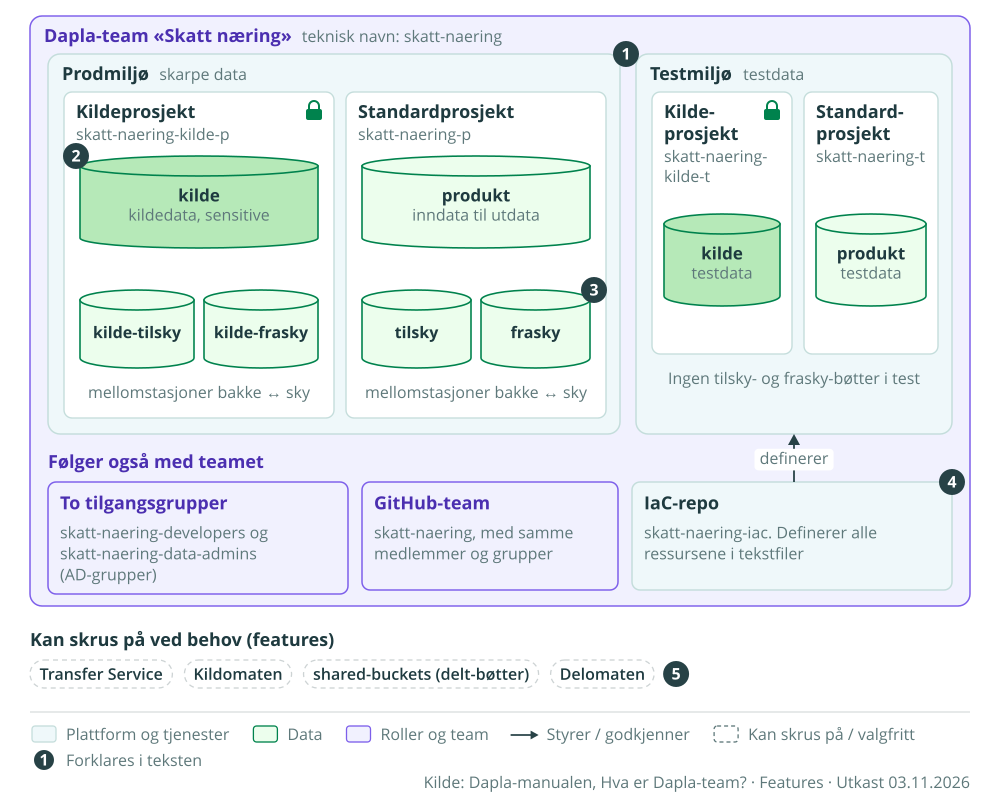

**Side:** Hva er Dapla-team? (under Ressurser, erstatter `dapla-team-cropped.png`)  
**Bildetekst:** Ressursene et Dapla-team får når det opprettes  
**Markører:**

1. Teamet får et prodmiljø for skarpe data og et testmiljø for testdata.
2. Kildedata ligger i et eget kildeprosjekt, fordi de er klassifisert som sensitive.
3. Bøttene tilsky og frasky er mellomstasjoner for overføring mellom bakke og sky. De finnes bare i prod.
4. Alle ressursene er definert i teamets IaC-repo.
5. Noen tjenester kan teamet skru på selv ved behov.

**Alt-tekst:** Dapla-teamet Skatt næring har et prodmiljø og et testmiljø med hvert sitt kildeprosjekt og standardprosjekt. I prod har kildeprosjektet bøttene kilde, kilde-tilsky og kilde-frasky, og standardprosjektet bøttene produkt, tilsky og frasky. I test finnes bare kilde og produkt. Teamet får også to tilgangsgrupper, et GitHub-team og et IaC-repo. Transfer Service, Kildomaten, shared-buckets og Delomaten kan skrus på.

[SVG](figurer/m01-hva-et-dapla-team-faar.svg) · [PNG](png/m01-hva-et-dapla-team-faar.png) · [Til toppen](#konseptfigurer-for-dapla-manualen)

---

### M02 Roller og tilgang

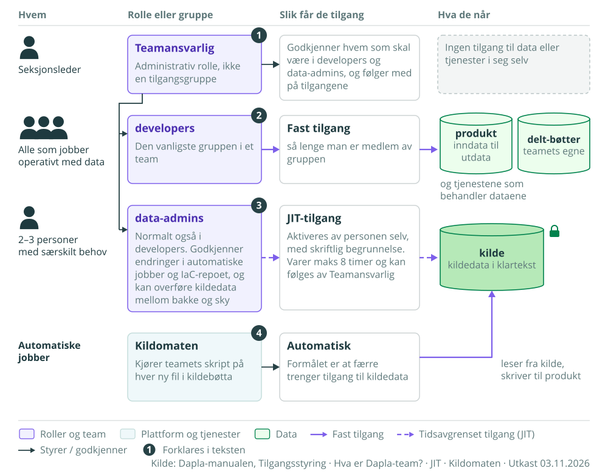

**Side:** Tilgangsstyring (erstatter `dp-tilganger-cropped.png`)  
**Bildetekst:** Hvem som har tilgang til hva i et Dapla-team, og hvordan  
**Markører:**

1. Teamansvarlig er seksjonslederen. Rollen gir ingen tilgang til data, men godkjenner hvem som får de tekniske rollene.
2. developers har fast tilgang til alt unntatt kildedata.
3. data-admins kan gi seg selv tidsbegrenset tilgang til kildedata (JIT).
4. Kildomaten behandler kildedata automatisk, slik at færre trenger tilgang.

**Alt-tekst:** Fire rader viser hvem, rolle, hvordan og hva. Seksjonslederen er Teamansvarlig og godkjenner tilganger. Alle som jobber operativt med data er developers og har fast tilgang til produktbøtta og delt-bøtter. 2–3 personer er data-admins og får tilgang til kildebøtta med JIT, maks 8 timer og med begrunnelse. Kildomaten leser fra kildebøtta og skriver til produktbøtta.

[SVG](figurer/m02-roller-og-tilgang.svg) · [PNG](png/m02-roller-og-tilgang.png) · [Til toppen](#konseptfigurer-for-dapla-manualen)

---

### M03 Datatilstander og bøtter

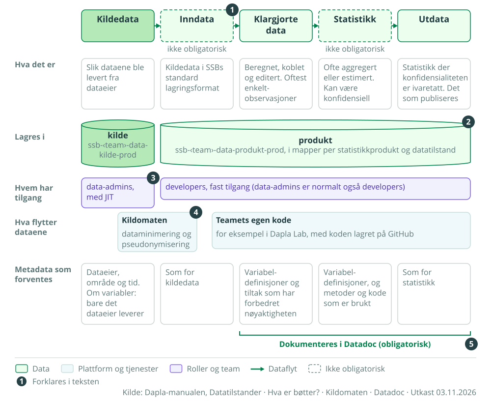

**Side:** Datatilstander (siden har ingen figur i dag. Erstatter den manglende `@fig-datatilstander`)  
**Bildetekst:** De fem datatilstandene, hvor de lagres og hva som forventes av metadata  
**Markører:**

1. Inndata og statistikk er ikke obligatoriske.
2. Alle tilstander unntatt kildedata lagres i produktbøtta, i mapper per statistikkprodukt og datatilstand.
3. Bare data-admins kan få tilgang til kildedata, og bare med JIT.
4. Kildomaten tar data fra kildedata til inndata. Resten gjør teamet med egen kode.
5. Klargjorte data, statistikk og utdata skal dokumenteres i Datadoc.

**Alt-tekst:** Kildedata, inndata, klargjorte data, statistikk og utdata i rekkefølge, med en kort forklaring av hver. Kildedata lagres i kildebøtta, de andre i produktbøtta. data-admins har JIT-tilgang til kildedata, developers fast tilgang til resten. Kildomaten flytter fra kildedata til inndata. Nederst står hvilke metadata som forventes for hver tilstand.

[SVG](figurer/m03-datatilstander-og-botter.svg) · [PNG](png/m03-datatilstander-og-botter.png) · [Til toppen](#konseptfigurer-for-dapla-manualen)

---

### M04 Deling av data

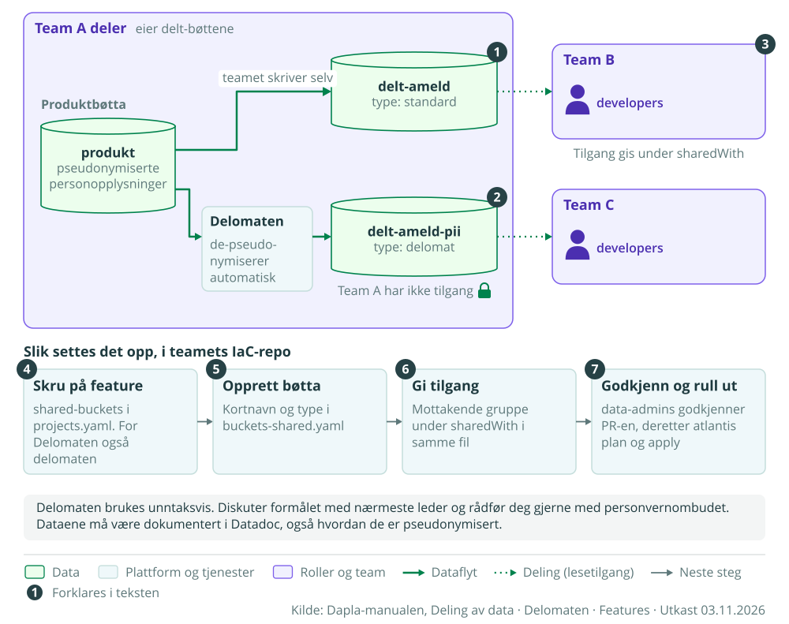

**Side:** Deling av data (Delomaten-siden kan bruke samme figur i stedet for `delomaten.svg`)  
**Bildetekst:** Deling med standard delt-bøtte og med Delomaten  
**Markører:**

1. En standard delt-bøtte skriver teamet til selv.
2. En delomat-bøtte fylles av Delomaten. Det delende teamet har ikke tilgang til den.
3. Mottakerne får lesetilgang gjennom sharedWith.
4–7. Oppsettet gjøres i IaC-repoet og godkjennes av data-admins.

**Alt-tekst:** Team A har pseudonymiserte data i produktbøtta. Teamet skriver selv til den standard delt-bøtta delt-ameld, som Team B leser. Delomaten de-pseudonymiserer og skriver til delomat-bøtta delt-ameld-pii, som Team C leser, uten at Team A har tilgang. Nederst fire steg for oppsett i IaC-repoet.

[SVG](figurer/m04-deling-av-data.svg) · [PNG](png/m04-deling-av-data.png) · [Til toppen](#konseptfigurer-for-dapla-manualen)

---

### M05 Kildomaten

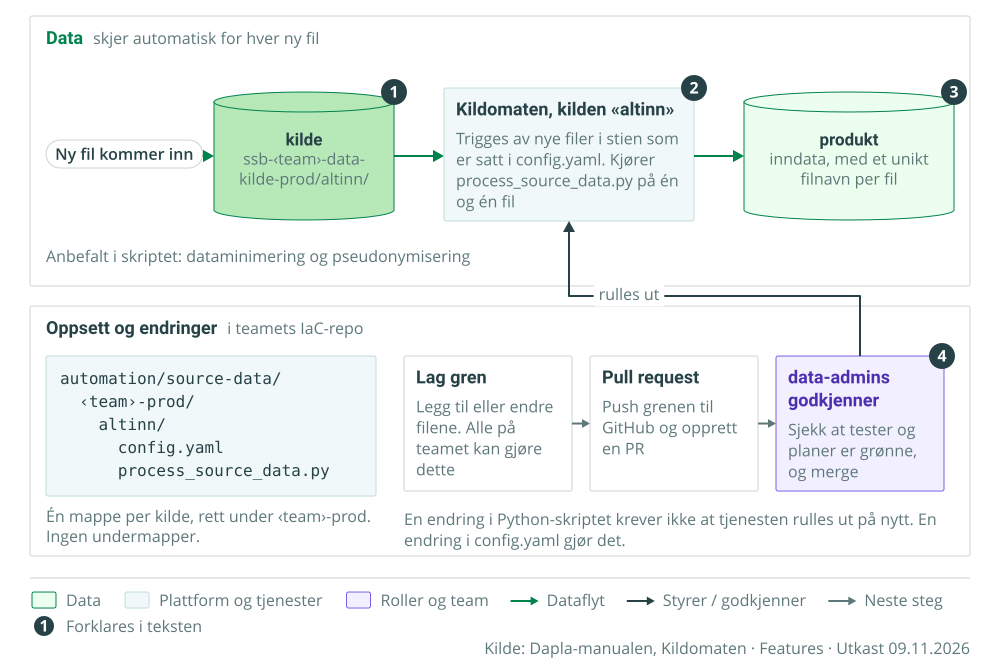

**Side:** Kildomaten (øverst, etter innledningen)  
**Bildetekst:** Slik behandler Kildomaten nye filer i kildebøtta, og slik settes den opp  
**Markører:**

1. En ny fil i stien som er satt i config.yaml starter Kildomaten.
2. Kildomaten kjører process_source_data.py på én og én fil.
3. Resultatet skrives til produktbøtta. Skriptet må gi hver fil et unikt navn.
4. Endringer krever en pull request som data-admins godkjenner. Deretter rulles tjenesten ut.

**Alt-tekst:** Øverst en dataflyt fra ny fil via kildebøtta og Kildomaten til produktbøtta. Nederst mappestrukturen i IaC-repoet og stegene gren, pull request og godkjenning av data-admins, som ruller ut Kildomaten.

[SVG](figurer/m05-kildomaten.svg) · [PNG](png/m05-kildomaten.png) · [Til toppen](#konseptfigurer-for-dapla-manualen)

---

### M06 Data inn til Dapla

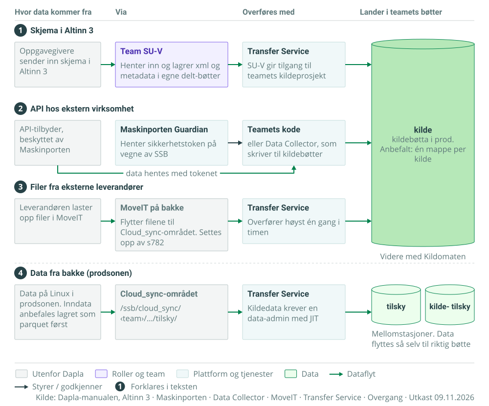

**Side:** Hurtigstart, eller en ny oversiktsside under Datafangst  
**Bildetekst:** Fire veier data kommer inn i teamets bøtter  
**Markører:**

1. Skjema fra Altinn 3 hentes av Team SU-V og overføres med Transfer Service.
2. Data fra eksterne API-er hentes med token fra Maskinporten Guardian.
3. Filer fra eksterne leverandører kommer via MoveIT på bakke.
4. Data fra prodsonen overføres via tilsky-bøttene, som er mellomstasjoner.

**Alt-tekst:** Fire rader, én per inngang, med kilde, mellomledd og overføringstjeneste. De tre første ender i teamets kildebøtte. Den fjerde ender i tilsky- eller kilde-tilsky-bøtta, og dataene flyttes derfra til riktig bøtte.

[SVG](figurer/m06-data-inn-til-dapla.svg) · [PNG](png/m06-data-inn-til-dapla.png) · [Til toppen](#konseptfigurer-for-dapla-manualen)

---

### M07 Maskinporten Guardian

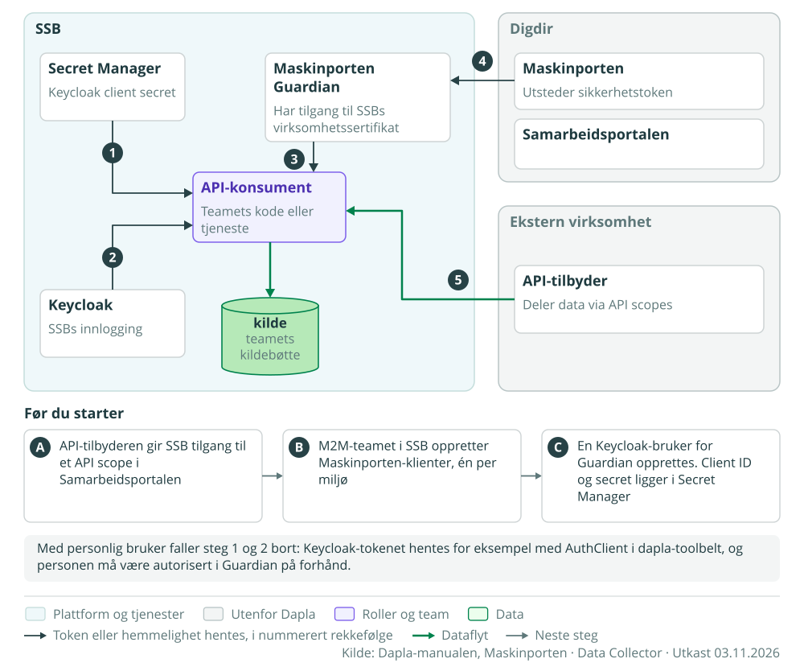

**Side:** Maskinporten (erstatter `maskinporten-guardian-flyt.svg` og Mermaid-figuren)  
**Bildetekst:** Slik henter teamets kode data fra et API beskyttet av Maskinporten  
**Markører:** Følger manualens steg 1–5 under «Flyt: M2M». A–C følger «Komme igang».

**Alt-tekst:** Innenfor SSB henter API-konsumenten en hemmelighet fra Secret Manager, et token fra Keycloak og et Maskinporten-token fra Maskinporten Guardian. Guardian henter tokenet fra Maskinporten hos Digdir med SSBs virksomhetssertifikat. Med tokenet henter konsumenten data fra API-tilbyderen og skriver dem til kildebøtta.

[SVG](figurer/m07-maskinporten-guardian.svg) · [PNG](png/m07-maskinporten-guardian.png) · [Til toppen](#konseptfigurer-for-dapla-manualen)

---

### M08 Git-arbeidsflyt

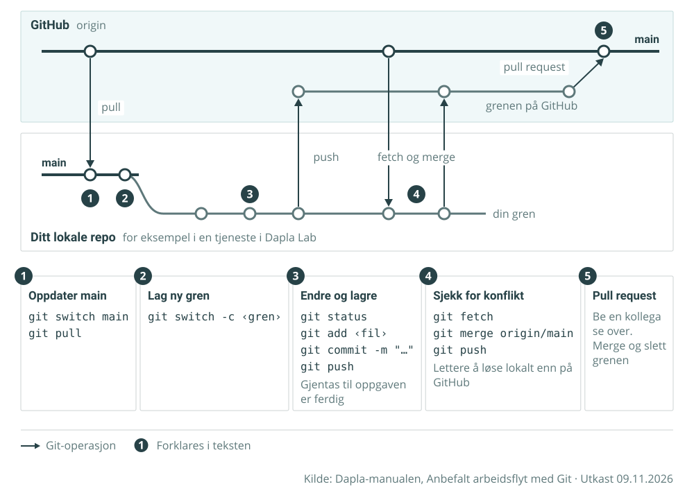

**Side:** Anbefalt arbeidsflyt med Git (under «Arbeidsflyt og repo illustrert», erstatter `git-arbeidsflyt-tegning.png`)  
**Bildetekst:** Anbefalt arbeidsflyt med Git, fra main til pull request  
**Markører:** Steg 1–5 er manualens steg 1, 2, 3–5, 6 og 7.

**Alt-tekst:** To baner, GitHub og ditt lokale repo. Du oppdaterer main, lager en gren, gjør commits og pusher. Du henter inn endringer fra main, pusher igjen og lager en pull request som merges til main. Under står kommandoene for hvert steg.

[SVG](figurer/m08-git-arbeidsflyt.svg) · [PNG](png/m08-git-arbeidsflyt.png) · [Til toppen](#konseptfigurer-for-dapla-manualen)

---

### M09 Metadata på Dapla

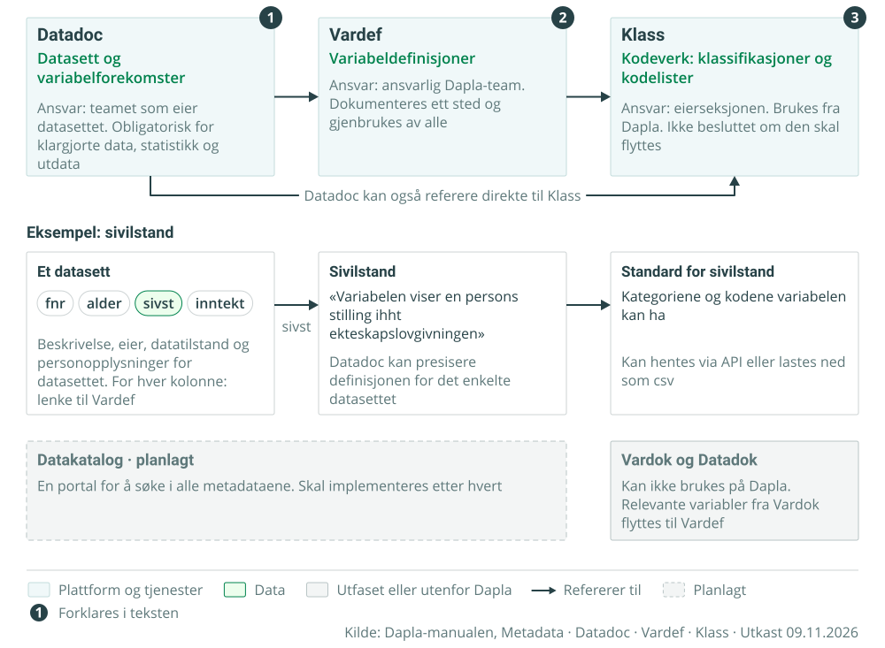

**Side:** Metadata (erstatter `metadata-core.png`. Datadoc-siden kan bruke eksempelet i stedet for `metadata-datadoc.png`)  
**Bildetekst:** Datadoc, Vardef og Klass, og hvordan de refererer til hverandre  
**Markører:**

1. Datadoc dokumenterer datasett og variabelforekomster.
2. Vardef dokumenterer variabeldefinisjoner én gang, til bruk overalt.
3. Klass dokumenterer kodeverk.

**Alt-tekst:** Tre systemer i rekke: Datadoc refererer til Vardef, som refererer til Klass. Datadoc kan også referere direkte til Klass. Eksempelet viser kolonnen sivst i et datasett, lenket til variabelen Sivilstand i Vardef og videre til Standard for sivilstand i Klass. Nederst datakatalogen, som er planlagt, og Vardok og Datadok, som ikke kan brukes på Dapla.

[SVG](figurer/m09-metadata-pa-dapla.svg) · [PNG](png/m09-metadata-pa-dapla.png) · [Til toppen](#konseptfigurer-for-dapla-manualen)

---

### M10 En tjeneste i Dapla Lab

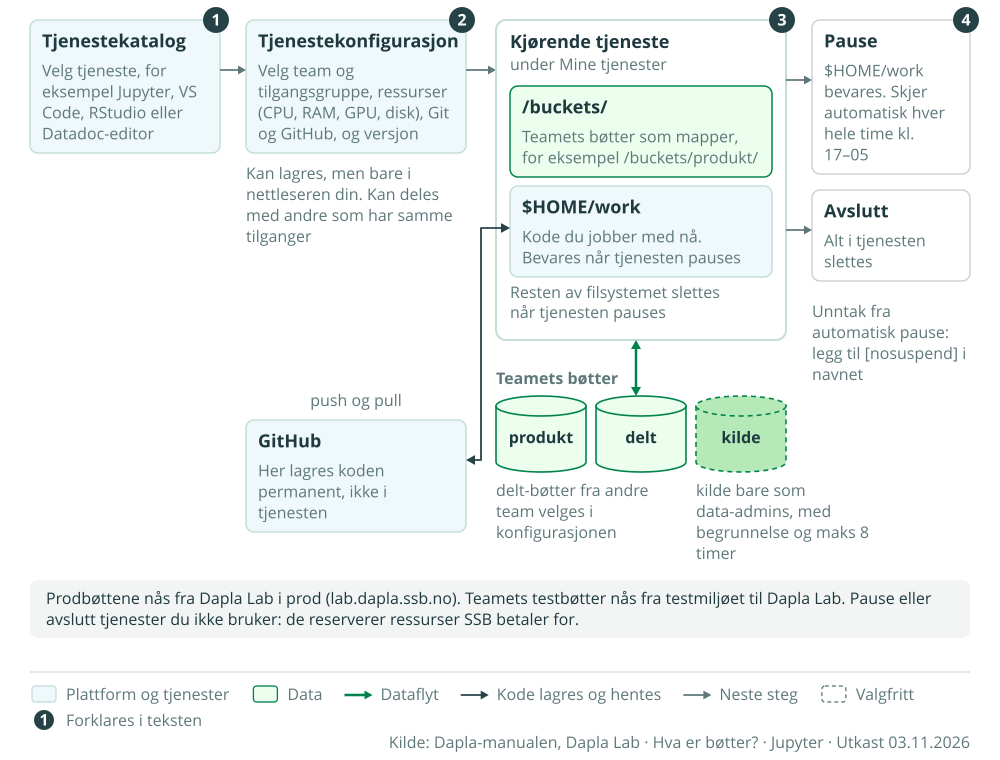

**Side:** Dapla Lab (under Funksjonalitet)  
**Bildetekst:** Fra tjenestekatalog til kjørende tjeneste, og hva som bevares  
**Markører:**

1. Du velger tjeneste i tjenestekatalogen.
2. I konfigurasjonen velger du team og tilgangsgruppe, ressurser og Git-oppsett.
3. I den kjørende tjenesten ligger bøttene under /buckets/ og arbeidet ditt i $HOME/work.
4. Ved pause bevares $HOME/work. Ved avslutning slettes alt.

**Alt-tekst:** Fire steg fra venstre: tjenestekatalog, tjenestekonfigurasjon, kjørende tjeneste og pause eller avslutt. Den kjørende tjenesten har teamets bøtter montert under /buckets/ og koden i $HOME/work, som lagres permanent på GitHub. Kildebøtta er bare tilgjengelig for data-admins.

[SVG](figurer/m10-en-tjeneste-i-dapla-lab.svg) · [PNG](png/m10-en-tjeneste-i-dapla-lab.png) · [Til toppen](#konseptfigurer-for-dapla-manualen)

---

### M11 Flytte statistikkproduksjon til Dapla

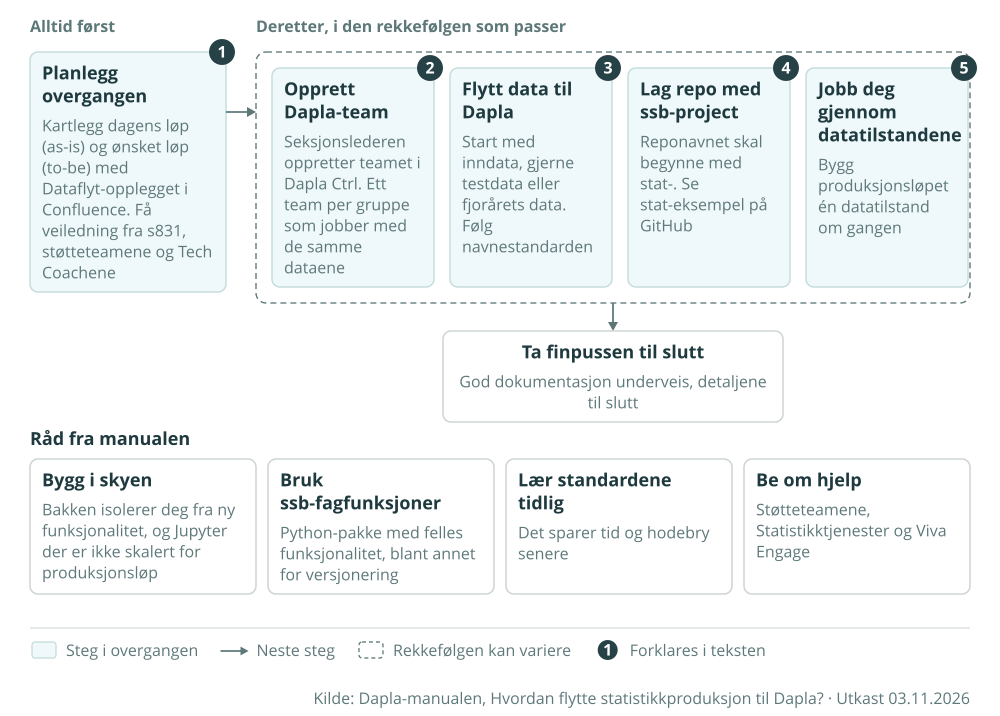

**Side:** Hvordan flytte statistikkproduksjon til Dapla? (erstatter `dapla-oppstart.png`)  
**Bildetekst:** Stegene i en overgang til Dapla  
**Markører:** Planleggingen kommer alltid først. Steg 2–5 tas i den rekkefølgen som passer.

**Alt-tekst:** Først planlegging. Deretter, i valgfri rekkefølge: opprett Dapla-team, flytt data, lag repo med ssb-project og jobb deg gjennom datatilstandene. Finpuss til slutt. Nederst fire råd fra manualen.

[SVG](figurer/m11-flytte-statistikk-til-dapla.svg) · [PNG](png/m11-flytte-statistikk-til-dapla.png) · [Til toppen](#konseptfigurer-for-dapla-manualen)

---

### M12 Altinn 3 fra skjema til bøtte

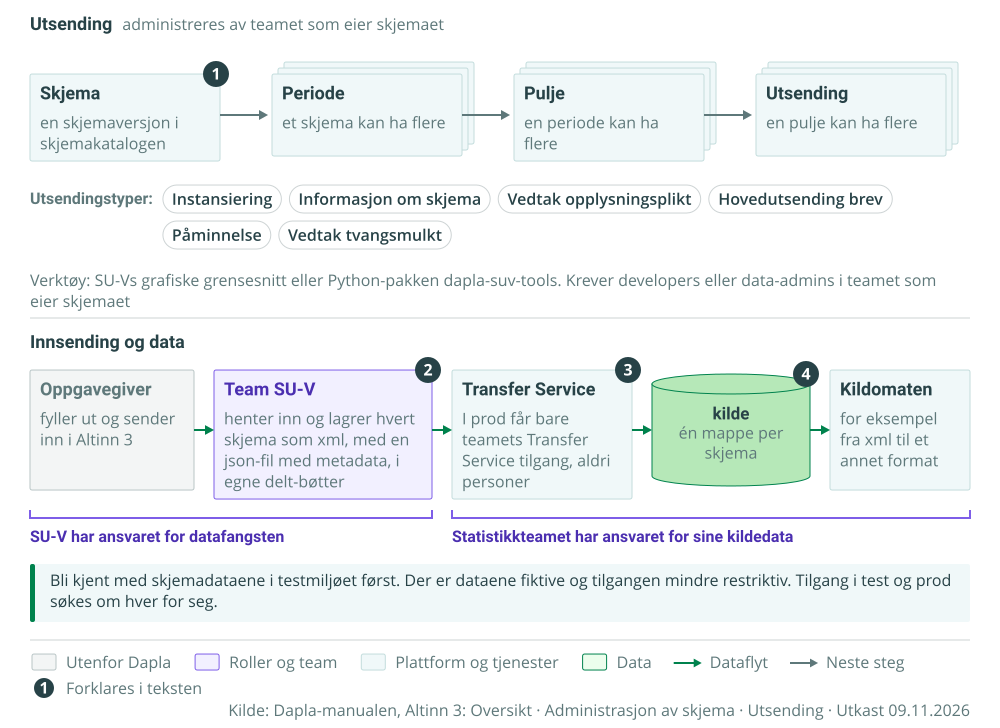

**Side:** Altinn 3: Oversikt (erstatter også `altinn-skjemaadm-avhengigheter.png` under Administrasjon av skjema)  
**Bildetekst:** Fra skjemautsending til data i teamets kildebøtte  
**Markører:**

1. Skjema, periode, pulje og utsending henger sammen som et hierarki der hvert nivå kan ha flere av det neste.
2. Team SU-V henter inn skjemaene og lagrer dem i egne delt-bøtter.
3. I prod får bare teamets Transfer Service tilgang til SU-Vs bøtter.
4. Teamet lagrer dataene som kildedata, med én mappe per skjema.

**Alt-tekst:** Øverst hierarkiet skjema, periode, pulje og utsending, med utsendingstypene. Nederst flyten fra oppgavegiver via Altinn 3, Team SU-V og Transfer Service til teamets kildebøtte og videre til Kildomaten. SU-V har ansvaret for datafangsten, statistikkteamet for kildedataene.

[SVG](figurer/m12-altinn3-fra-skjema-til-botte.svg) · [PNG](png/m12-altinn3-fra-skjema-til-botte.png) · [Til toppen](#konseptfigurer-for-dapla-manualen)
